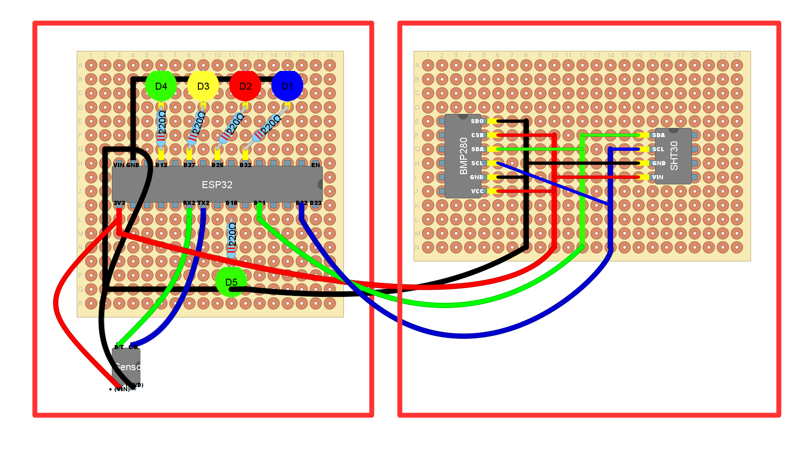
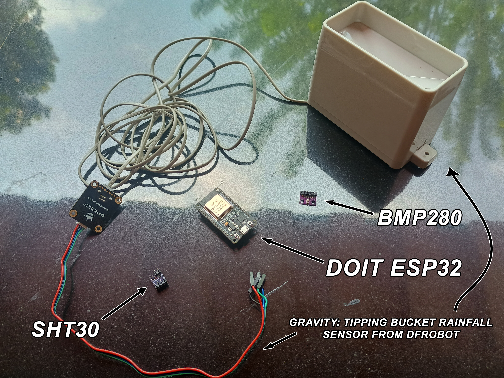
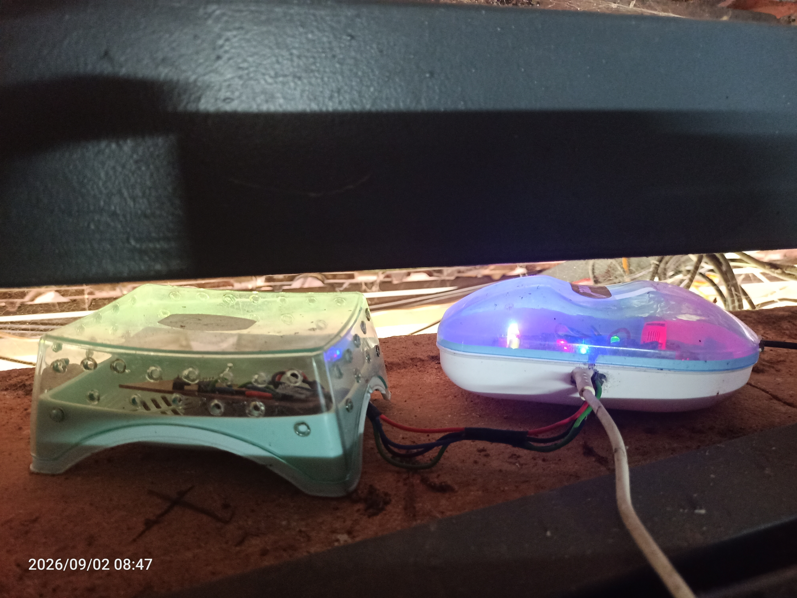
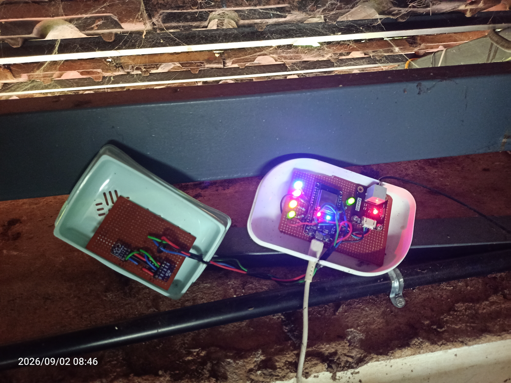
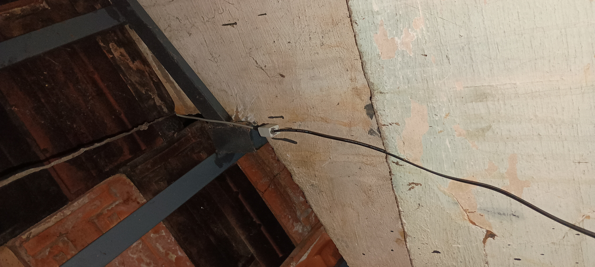
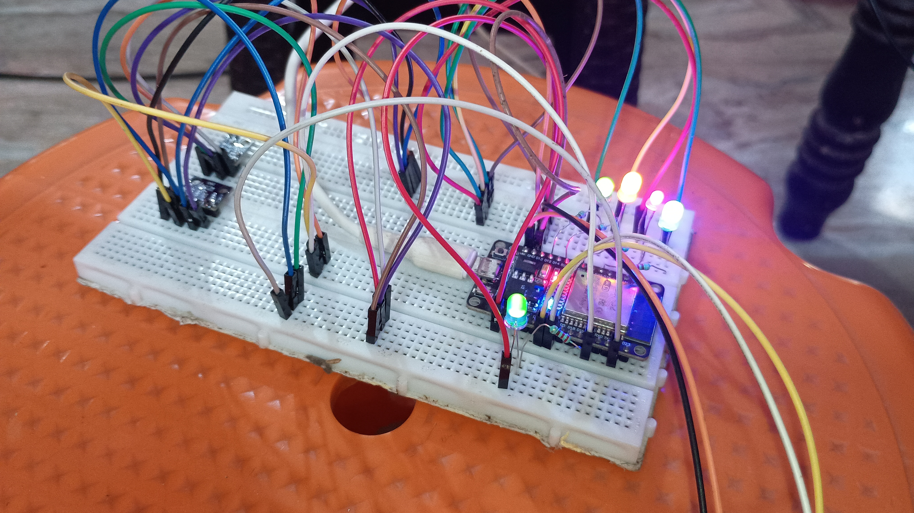
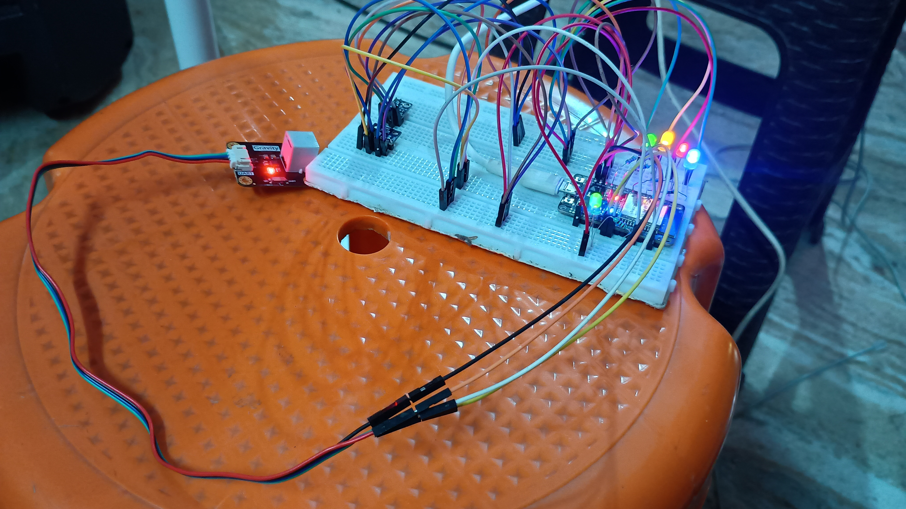
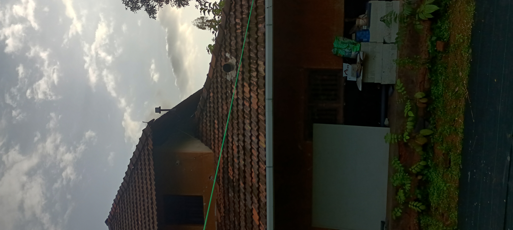
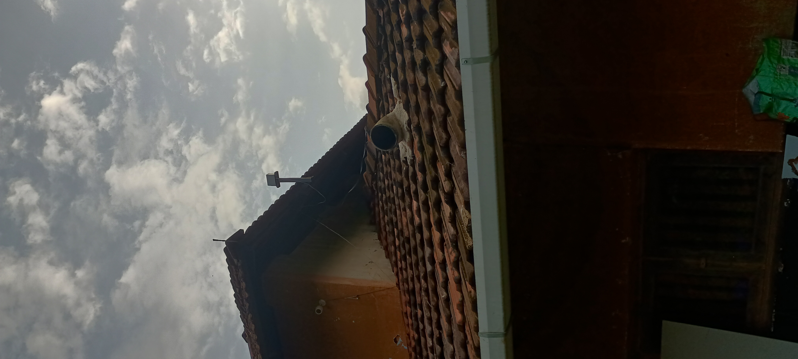
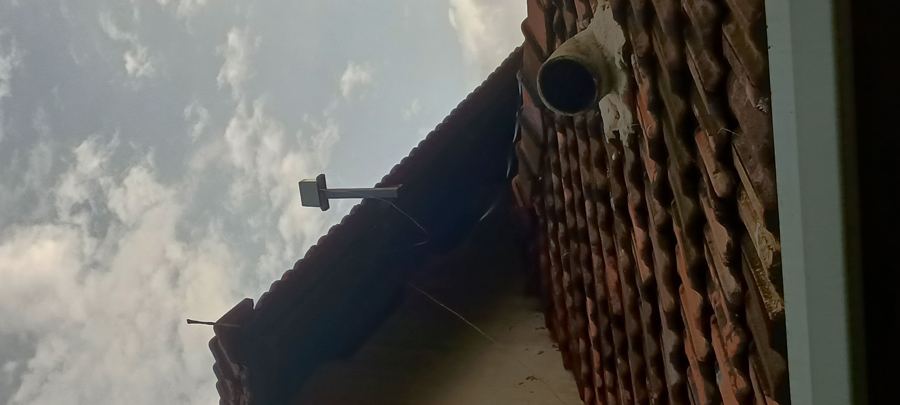

# ESP32 Rainfall Monitor Firmware

This repository contains the ESP32 firmware for a remote rainfall monitoring system developed to track Kerala's hyper-local and often rapidly changing weather patterns. It measures rainfall rate, barometric pressure, temperature, and humidity. The firmware publishes sensor readings to an MQTT broker (HiveMQ) and sends Telegram alerts when rainfall is detected. The companion Android app receives and displays the data.

## Overview

The firmware runs on a DOIT ESP32 dev board and interfaces with:
- **DFRobot Rainfall Sensor (SEN0575)** - Tipping bucket style sensor for measuring rainfall accumulation
- **BMP280** - Barometric pressure and temperature sensor
- **SHT30** - Humidity and temperature sensor

Sensor readings are published to MQTT every 10 minutes (or when triggered by the check interval). Rainfall rate is calculated from the change in accumulated rainfall over the interval. Telegram alerts are sent when rainfall is detected, with an intensity label (Light/Moderate/Heavy/Violent Rain).

## Companion App

The source code for the companion Android app is available in the [Rainfall-App](https://github.com/grassy345/Rainfall-App) repository.

## Features

- **Periodic sensor readings**: Reads rainfall, pressure, temperature, and humidity every 10 minutes
- **Rainfall rate calculation**: Computes hourly rainfall rate (mm/hr) from accumulated rainfall deltas
- **MQTT telemetry**: Publishes JSON payloads with rate, pressure, temperature, humidity, and timestamp to HiveMQ Cloud
- **Telegram alerts**: Sends alerts with intensity label and timestamp when rain is detected (rate > 0)
- **Retry logic**: 3-attempt retry with 5-second timeouts for Telegram API calls
- **NTP time sync**: Synchronizes system time for accurate timestamps in alerts and MQTT payloads
- **LED status indicators**: Visual feedback for WiFi, NTP sync, sensors (rainfall/BMP280/SHT30), and MQTT connectivity
- **Resilient reconnection**: Automatic WiFi and MQTT reconnection with retry loops
- **Gap detection**: Handles connectivity outages by resetting tracking if gap exceeds 11 minutes (660000 ms) to avoid false spikes
- **Headless operation**: Designed to run unattended when powered via adapter

## Hardware Requirements

- **DOIT ESP32 Development Board** (DevKit v1)
- **DFRobot SEN0575 Rainfall Sensor (UART)** - connected to Serial2 (GPIO16 RX, GPIO17 TX)
- **BMP280 I2C Barometric Pressure/Temperature Sensor** (address 0x76)
- **SHT30 I2C Humidity/Temperature Sensor** (address 0x44)
- **Enclosure** for weatherproofing outdoor components
- **Power adapter** (5V) for continuous operation

## Pin Configuration

| Component | Interface | ESP32 Pins/Notes |
|-----------|-----------|------------------|
| Rainfall Sensor (SEN0575) | UART (Serial2) | RX: GPIO16, TX: GPIO17 |
| BMP280 | I2C (Wire) | SDA/SCL as per default I2C, address 0x76 |
| SHT30 | I2C (Wire) | SDA/SCL as per default I2C, address 0x44 |
| WiFi Status LED | Digital | GPIO2 |
| MQTT Status LED | Digital | GPIO18 |
| NTP Sync LED | Digital | GPIO32 |
| Rainfall Sensor Status LED | Digital | GPIO25 |
| BMP280 Status LED | Digital | GPIO27 |
| SHT30 Status LED | Digital | GPIO12 |

## Firmware Structure

The main firmware is located at: [`sketch_jul20a/sketch_jul20a.ino`](./sketch_jul20a/sketch_jul20a.ino)

Key functions:

- `setup()` — Initializes WiFi, NTP time sync, sensors (rainfall/BMP280/SHT30), MQTT connection, sets up LED pins
- `loop()` — Periodic 10-minute checks (600000 ms), reads sensors, computes rate, publishes to MQTT, sends Telegram alerts if raining; includes gap detection (>11 min) and MQTT keepalive
- `ensureWiFi()` — Reconnects WiFi if dropped
- `reconnectMQTT()` — Reconnects MQTT with retry logic
- `publishStatus(rate, pressure, temperature, humidity)` — Builds and publishes JSON payload to MQTT topic `rainfall/status`
- `sendTelegramAlert(rate)` — Sends HTTPS POST to Telegram Bot API with retry logic (3 attempts, 5s timeout)
- `getIntensityLabel(rate)` — Maps rate to intensity: Light (≤2.5 mm/hr), Moderate (≤7.5 mm/hr), Heavy (≤50 mm/hr), Violent (>50 mm/hr)

### MQTT Payload Format

```json
{
  "rate": 1.68,
  "pressure": 997.78,
  "temperature": 26.03,
  "humidity": 94.20,
  "timestamp": 1785344133000
}
```

### Telegram Alert Format

```
🌧️ Light Rain: 1.68 mm/hr
29 Jul 2026, 10:40 PM
```

## Setup Instructions

1. **Clone this repository** to your local machine
2. **Open `sketch_jul20a/sketch_jul20a.ino`** in the Arduino IDE
3. **Install required libraries** (see [Libraries](#libraries) section)
4. **Update credentials** in the firmware:
   - `ssid` and `wifiPassword` — Your WiFi network
   - `mqttBroker`, `mqttUsername`, `mqttPassword` — HiveMQ Cloud credentials
   - `telegramToken` and `telegramChatId` — Telegram bot token and group/chat ID
5. **Connect hardware** according to the pin configuration
6. **Select board**: `DOIT ESP32 DEVKIT V1` in Arduino IDE
7. **Upload** the sketch to your ESP32
8. **Monitor** via Serial at 115200 baud during initial testing (optional)

## Libraries

The following Arduino libraries are required:

- [DFRobot_RainfallSensor](https://wiki.dfrobot.com/sen0575/) — For SEN0575 UART rainfall sensor
- [NetworkClientSecure](https://docs.espressif.com/projects/arduino-esp32/en/latest/api/ssl.html) — ESP32 secure TLS client (included with ESP32 core)
- [MQTT](https://github.com/256dpi/arduino-mqtt) — MQTT client library
- [Adafruit_BMP280](https://learn.adafruit.com/adafruit-bmp280-barometric-pressure-plus-temperature-sensor-breakout/arduino-test) — BMP280 sensor driver
- [SensirionI2cSht3x](https://sensirion.com/products/catalog/SHT30-DIS-B) — SHT30 sensor driver
- [WiFi](https://docs.espressif.com/projects/arduino-esp32/en/latest/api/wifi.html) — ESP32 WiFi (ESP32 core)
- [Wire](https://www.arduino.cc/reference/en/language/functions/communication/wire/) — I2C communication
- [time.h](https://docs.espressif.com/projects/arduino-esp32/en/latest/api/time.html) — NTP time functions (ESP32 core)

Install these via Arduino Library Manager where available, or from the links above.

## Assets

### Diagrams

<table>
  <tr>
    <td></td>
  </tr>
  <tr>
    <td>System layout/design created with DIY Layout Creator (Windows 10)</td>
  </tr>
</table>

### Overview

<table>
  <tr>
    <td></td>
  </tr>
  <tr>
    <td>Overview of all components with labels</td>
  </tr>
</table>

### Enclosure (Inside)

| Closed Enclosure | Open Enclosure |
|---|---|
|  |  |
| ESP32, BMP280, and SHT30 mounted (closed) | Component placement with enclosure opened |

### Wiring

| Wiring Inside Enclosure |
|---|
|  |
| Wiring details inside the enclosure/housing |

### Breadboard Prototyping

| Prototype 1 | Prototype 2 |
|---|---|
|  |  |
| Initial breadboard prototyping | Progressed breadboard prototyping |

### Outdoor Installation

#### Progressive zoom-in/pan of the outdoor installation

| Outside 1 (Wide) | Outside 2 | Outside 3 |
|---|---|---|
|  |  |  |

| Outside 4 | Outside 5 (Close-up) |
|---|---|
|  |  |

### Video

| Walkthrough |
|---|
| <video src="https://github.com/user-attachments/assets/a30e7ee2-6b0a-4a9b-ac5d-f77bea0ad706" controls width="500"></video> |
| Inside walkthrough showing the setup and wiring ([View original source file](assets/videos/inside_walkthrough.mp4)) |

## References

The following resources were referenced during development:

1. [DFRobot SEN0575 Wiki](https://wiki.dfrobot.com/sen0575/) — Rainfall sensor documentation
2. [Adafruit BMP280 Guide](https://learn.adafruit.com/adafruit-bmp280-barometric-pressure-plus-temperature-sensor-breakout/arduino-test) — BMP280 integration example
3. [Sensirion SHT30 Product Page](https://sensirion.com/products/catalog/SHT30-DIS-B) — SHT30 sensor specifications
4. [MQTT.org](https://mqtt.org/software/) — MQTT protocol overview
5. [Arduino Libraries](https://docs.arduino.cc/libraries/) — Library discovery
6. [Arduino MQTT Library (256dpi)](https://github.com/256dpi/arduino-mqtt) — MQTT client implementation
7. [Robocraze BMP280 Sensor Module](https://robocraze.com/products/bmp280-sensor-module) — Product details
8. [Robocraze SHT30-DIS I2C Sensor](https://robocraze.com/products/sensirion-sht30-dis-i2c-humidity-temperature-sensor) — Product details
9. [Arduino Language Reference](https://docs.arduino.cc/language-reference/) — Core language docs
10. [Arduino Programming Guide](https://docs.arduino.cc/programming/) — Getting started
11. [ESP32 Arduino Core Documentation](https://docs.espressif.com/projects/arduino-esp32/en/latest/index.html) — ESP32-specific APIs and examples

## Notes

- **Board**: DOIT ESP32 DEVKIT V1
- **Interval**: 10-minute check cycle (600000 ms)
- **Gap tolerance**: >11 minutes triggers counter reset to avoid false rainfall spikes after outages
- **Security**: Uses TLS (`NetworkClientSecure`) with `setInsecure()` for Telegram/MQTT connections (suitable for this deployment)
- **Telegram alerts**: Triggered only when `rate > 0`. During continuous rain, alerts fire on each 10-minute cycle that detects rain
- **Credentials**: Update placeholder values in `sketch_jul20a.ino` before uploading

## License

This project is licensed under the MIT License. The full license text is provided in the [LICENSE](LICENSE) file in this repository.
